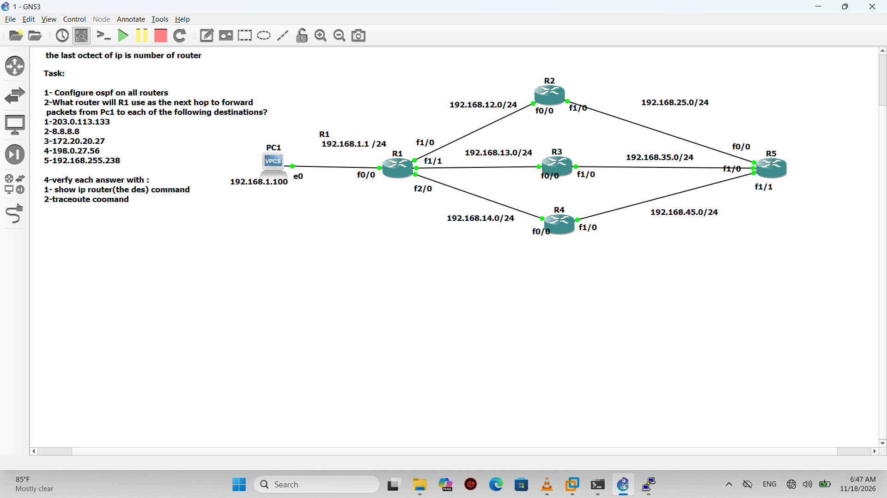

# Lab 02: Layer 3 Forwarding and OSPF

## Overview

This lab demonstrates Layer 3 forwarding and dynamic routing using OSPF in a five-router network topology with one PC.

The lab focuses on routing-table analysis, OSPF neighbor relationships, next-hop selection, and Equal-Cost Multipath (ECMP).

## Objectives

- Configure and verify OSPF on five routers.
- Analyze Layer 3 forwarding decisions.
- Identify next-hop routers selected by R1.
- Examine OSPF routing-table entries.
- Understand Equal-Cost Multipath (ECMP).
- Verify packet forwarding paths using traceroute.

## Network Devices

- 5 Cisco routers (R1–R5)
- 1 PC
- IPv4
- OSPF Process 1

## Network Topology

## Destination Addresses

The following five remote loopback destinations are hosted on R5:

1. 203.0.113.133
2. 8.8.8.8
3. 172.20.20.27
4. 198.0.27.56
5. 192.168.255.238

## Verification Commands

The following Cisco IOS commands were used during the lab:

| Command | Purpose |
|---|---|
| `show ip interface brief` | Verify interface status and IP addressing |
| `show ip route` | Examine the routing table |
| `show ip ospf neighbor` | Verify OSPF neighbor relationships |
| `show ip route <destination>` | Identify the route and next hops |
| `traceroute <destination>` | Examine packet forwarding paths |

## OSPF Neighbor Verification

R1 successfully established three OSPF neighbor adjacencies:

| Neighbor | IP Address | Interface | State |
|---|---|---|---|
| R2 | 192.168.12.2 | FastEthernet1/0 | FULL/BDR |
| R3 | 192.168.13.3 | FastEthernet1/1 | FULL/BDR |
| R4 | 192.168.14.4 | FastEthernet2/0 | FULL/BDR |

All three neighbors reached the FULL state.

## Next-Hop Decision Analysis

R1's routing table was examined using `show ip route <destination>` for all five remote loopback destinations hosted on R5.

All five destinations were learned through OSPF process 1 as intra-area routes.

### Routing Results

| Destination | Prefix | Next Hops | Metric |
|---|---|---|---|
| 203.0.113.133 | /32 | 192.168.14.4, 192.168.13.3, 192.168.12.2 | 3 |
| 8.8.8.8 | /32 | 192.168.14.4, 192.168.13.3, 192.168.12.2 | 3 |
| 172.20.20.27 | /32 | 192.168.14.4, 192.168.13.3, 192.168.12.2 | 3 |
| 198.0.27.56 | /32 | 192.168.14.4, 192.168.13.3, 192.168.12.2 | 3 |
| 192.168.255.238 | /32 | 192.168.14.4, 192.168.13.3, 192.168.12.2 | 3 |

### Next-Hop Mapping

| Next-Hop Router | Next-Hop IP | Exit Interface |
|---|---|---|
| R4 | 192.168.14.4 | FastEthernet2/0 |
| R3 | 192.168.13.3 | FastEthernet1/1 |
| R2 | 192.168.12.2 | FastEthernet1/0 |

### ECMP Analysis

All five destinations have three equal-cost OSPF paths.

- Administrative distance: 110
- OSPF metric: 3
- Route type: Intra-area
- Number of equal-cost next hops: 3

R1 installs all three next hops in its routing table, demonstrating Equal-Cost Multipath (ECMP).

This enables the router to use multiple equal-cost paths for forwarding traffic toward R5.

## Traceroute Analysis

Traceroute was performed from R1 toward all five remote destinations.

The results consistently showed:

**First hop:**
- 192.168.12.2 (R2)
- 192.168.13.3 (R3)
- 192.168.14.4 (R4)

**Second hop:**
- 192.168.25.5 (R5)
- 192.168.35.5 (R5)
- 192.168.45.5 (R5)

These results are consistent with the three equal-cost paths installed by OSPF in R1's routing table.

## Lab Evidence

### 1. Network Topology

See the `Topology` folder for the network diagram.

### 2. Router Interface Verification

| Router | Screenshot |
|---|---|
| R1 | [R1 Interface Status](Verification/R1-ip.png) |
| R2 | [R2 Interface Status](Verification/R2-ip.png) |
| R3 | [R3 Interface Status](Verification/R3-ip.png) |
| R4 | [R4 Interface Status](Verification/R4-ip.png) |
| R5 | [R5 Interface Status](Verification/R5-ip.png) |

### 3. Routing Table Verification

| Router | Screenshot |
|---|---|
| R1 | [R1 Routing Table](Verification/1-R1_Roting-table.png) |
| R2 | [R2 Routing Table](Verification/2-R2_Roting-table.png) |
| R3 | [R3 Routing Table](Verification/3-R3_Roting-table.png) |
| R4 | [R4 Routing Table](Verification/4-R4_Roting-table.png) |
| R5 | [R5 Routing Table](Verification/5-R5_Roting-table.png) |

### 4. OSPF Neighbor Verification

- [R1 OSPF Neighbors](Verification/ospf-neighbors.png)
- [R5 OSPF Neighbors](Verification/ospf-neighbors5.png)

### 5. Routing and Traceroute Evidence

- [Routing Command Evidence 1](Verification/show%20ip%20router%20command1.png)
- [Routing Command Evidence 2](Verification/show%20ip%20router%20-command2.png)
- [Traceroute Results](Verification/traceoute%20coomand.png)

## Technical Conclusion

This lab demonstrates successful OSPF neighbor establishment, dynamic route learning, and Layer 3 forwarding across a five-router topology.

R1 successfully learned five remote loopback routes through three equal-cost next hops. Traceroute results confirmed responses through the available paths toward R5.

The lab provides practical experience with OSPF routing-table interpretation, next-hop selection, ECMP, and network troubleshooting.

## Course Information

- **Course:** CCNP Enterprise
- **Lab:** 02
- **Topic:** Layer 3 Forwarding and OSPF
- **Platform:** GNS3
