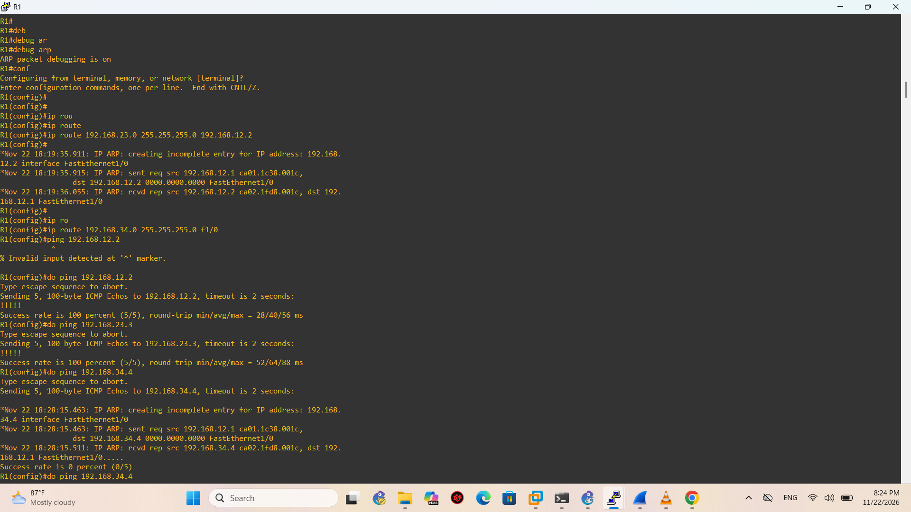

# Lab 03: ARP and Static Routing

## Overview

This lab explores ARP behavior and its relationship with static routing in Cisco routers.

The lab focuses on ARP resolution, recursive static routes, directly connected static routes, and packet analysis using Wireshark.

## Objectives

- Investigate ARP behavior using debug commands.
- Capture packets between R1 and R2.
- Configure recursive and directly connected static routes.
- Analyze ARP requests and replies.
- Troubleshoot connectivity between routers.
- Examine the ARP table.
- Modify the ARP timeout.
- Analyze ARP exchanges using Wireshark.

## Lab Topology


## Lab Configuration and Results

### Static Routing Configuration

Two static routes were configured on R1 to compare recursive routing with directly connected static routing.

**Recursive Static Route**

A next-hop IP address was specified. The router must perform a recursive lookup to determine the outgoing interface.

```cisco
ip route 192.168.23.0 255.255.255.0 192.168.12.2
```

**Directly Connected Static Route**

The outgoing interface was specified directly in the static route.

```cisco
ip route 192.168.34.0 255.255.255.0 FastEthernet1/0
```

These configurations were used to investigate how the router resolves the next hop, performs ARP resolution, and forwards packets toward destination networks.
.

### Ping Tests and ARP Behavior

Connectivity tests were performed from R1 to different destinations to observe how ARP operates during packet forwarding.

#### Ping R2 F1/0

A ping was performed from R1 to the IP address of R2's FastEthernet1/0 interface.

This test was used to observe ARP resolution for a directly reachable neighbor and identify ARP messages generated during connectivity testing.

#### Ping R3 F1/0

A ping was performed from R1 to R3's FastEthernet1/0 interface.

The test demonstrates the difference between ARP resolution for the destination host and ARP resolution for the next-hop router when the destination belongs to a remote network.

#### Ping R4 F1/1

A ping was performed from R1 to R4's FastEthernet1/1 interface. The initial connectivity test was unsuccessful, requiring investigation of the routing and ARP behavior.

This test highlights the importance of correct routing and next-hop resolution when reaching remote destinations.

## Screenshots

### ARP Debugging



## Wireshark Analysis

Packet capture analysis will be added after completing the lab.

## Conclusion

This lab demonstrates how ARP operates during IP forwarding and how routing decisions influence ARP resolution.
