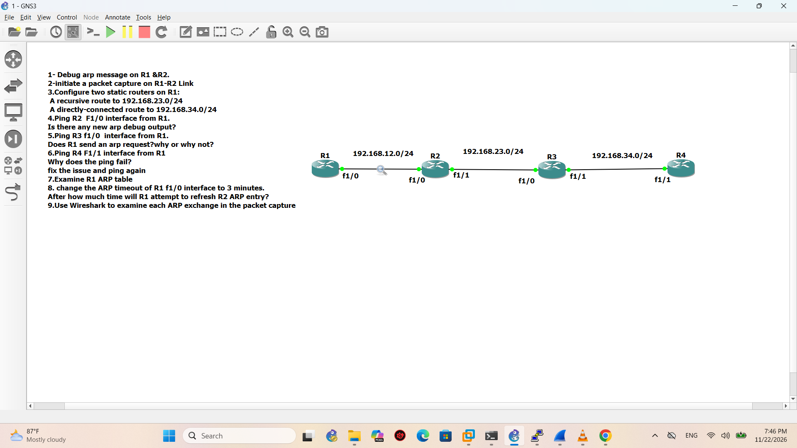
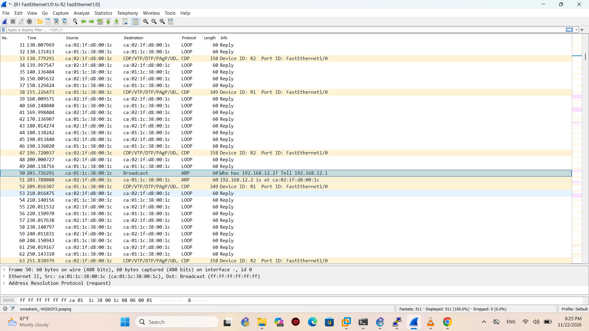

# Lab 03: ARP and Static Routing

## Overview

This lab explores Address Resolution Protocol (ARP) behavior and its relationship with static routing in Cisco routers.

The lab focuses on ARP resolution, recursive static routes, directly connected static routes, connectivity troubleshooting, and packet analysis using Wireshark.

## Objectives

- Investigate ARP behavior using debug commands.
- Capture packets between R1 and R2.
- Configure recursive and directly connected static routes.
- Analyze ARP requests and replies.
- Troubleshoot connectivity between routers.
- Examine the ARP table.
- Modify the ARP timeout.
- Analyze ARP exchanges using Wireshark.

## Lab Topology



## Lab Configuration and Results

### Static Routing Configuration

Two static routes were configured on R1 to compare recursive routing with directly connected static routing.

**Recursive Static Route**

A next-hop IP address was specified. The router performs a recursive lookup to determine the outgoing interface.

```cisco
ip route 192.168.23.0 255.255.255.0 192.168.12.2
```

**Directly Connected Static Route**

The outgoing interface was specified directly in the static route.

```cisco
ip route 192.168.34.0 255.255.255.0 FastEthernet1/0
```

These configurations were used to investigate how the router resolves the next hop, performs ARP resolution, and forwards packets toward destination networks.

### Ping Tests and ARP Behavior

Connectivity tests were performed from R1 to different destinations to observe how ARP operates during packet forwarding.

#### Ping R2 F1/0

A ping was performed from R1 to the IP address of R2's FastEthernet1/0 interface.

This test was used to observe ARP resolution for a directly connected neighbor.

#### Ping R3 F1/0

A ping was performed from R1 to R3's FastEthernet1/0 interface.

This test demonstrates how a router uses the next-hop router's MAC address when forwarding packets toward a remote network, rather than resolving the remote destination's MAC address directly.

#### Ping R4 F1/1

A ping was performed from R1 to R4's FastEthernet1/1 interface.

The initial connectivity test was unsuccessful, requiring investigation of the routing configuration and ARP behavior.

This test highlights the importance of correct routing and next-hop resolution when reaching remote destinations.

### ARP Table and Aging

The ARP table was examined on R1 to identify the mappings between IPv4 addresses and MAC addresses.

```cisco
show ip arp
```

The ARP table allows the router to associate IP addresses with Layer 2 addresses, enabling Ethernet frame delivery to the appropriate next-hop device.

#### ARP Timeout Experiment

The ARP timeout on R1's FastEthernet1/0 interface was changed to three minutes.

```cisco
arp timeout 180
```

The ARP entry for R2 was monitored to observe when it expired and when ARP resolution occurred again.

This experiment demonstrates how ARP cache aging affects address resolution and the generation of ARP traffic.

## Wireshark Analysis

Wireshark was used to capture and analyze ARP traffic on the link between R1 and R2.

The packet capture was examined to identify the following ARP operations:

1. **ARP Request:** A device broadcasts a request to discover the MAC address associated with an IPv4 address.
2. **ARP Reply:** The device owning the requested IP address responds with its MAC address.
3. **ARP Cache:** After successful resolution, the IP-to-MAC mapping can be stored in the ARP table.
4. **ARP Aging:** ARP entries eventually expire, requiring address resolution again when needed.

The packet capture helps demonstrate how ARP operates at Layer 2 and supports IPv4 communication over Ethernet.

## Screenshots

### ARP Debugging

The ARP debugging output was examined to monitor address resolution activity on the routers.


### Wireshark Packet Analysis

The following screenshot shows the ARP packet capture between R1 and R2.



## Conclusion

This lab provided practical experience with Address Resolution Protocol (ARP) and static routing in a multi-router network environment.

The main concepts demonstrated were:

- How ARP requests and replies resolve IPv4 addresses to MAC addresses.
- How routers use ARP to communicate with directly connected next-hop devices.
- The difference between recursive and directly connected static routes.
- How routing decisions affect packet forwarding and ARP resolution.
- How ARP entries are maintained and refreshed through cache aging.
- How Wireshark can be used to capture and analyze ARP traffic.

The lab strengthened my understanding of the relationship between Layer 2 address resolution and Layer 3 packet forwarding.
