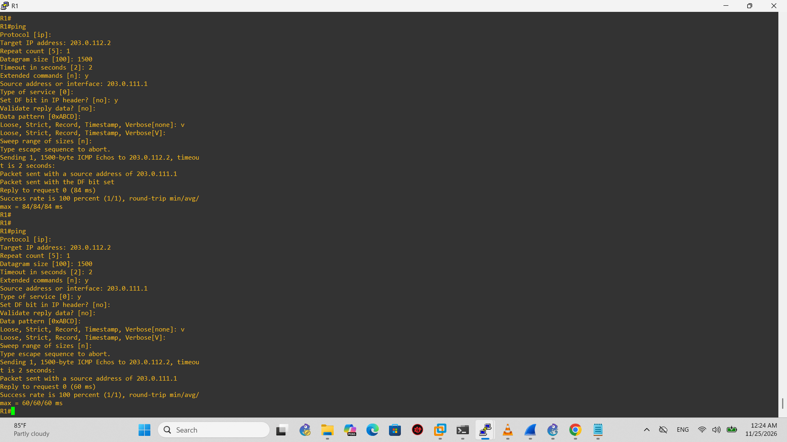
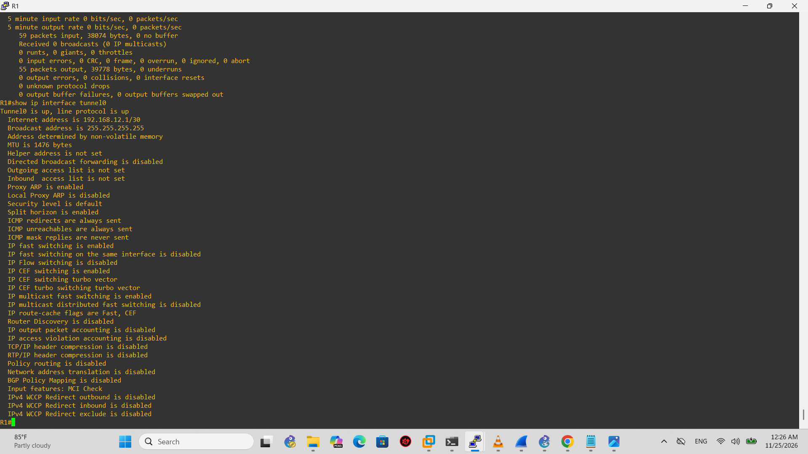
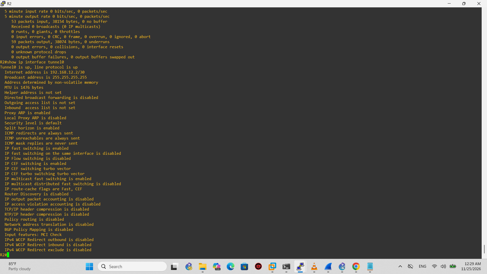
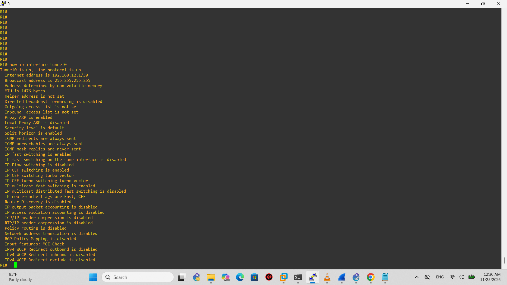
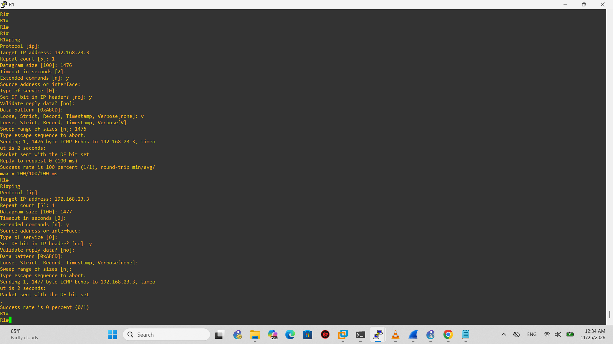

# Lab 04 – GRE Tunnel, MTU, Path MTU Discovery & IP Fragmentation


## 1. Project Overview

This lab explores GRE tunneling, Maximum Transmission Unit (MTU), IP fragmentation, and the Don't Fragment (DF) bit using Cisco IOS routers.

The objective is to understand how GRE encapsulation affects packet size, investigate fragmentation behavior, and analyze MTU-related packet delivery.

This is a practical CCNP Enterprise lab focused on network configuration, verification, and troubleshooting.

## 2. Lab Objectives

- Configure and verify a GRE tunnel.
- Perform extended ping tests using different packet sizes.
- Understand the DF bit and its effect on IP fragmentation.
- Investigate the effective GRE tunnel MTU.
- Modify the tunnel IP MTU to 1500 bytes.
- Compare ping results with DF enabled and disabled.
- Investigate end-to-end MTU behavior between R1 and R3.
- Understand the relationship between underlay MTU and GRE encapsulation.
- Review Path MTU Discovery configuration.

## 3. Network Topology

R1 connects to an ISP router. The ISP connects to R2. R2 connects to SW1, which connects to R3.

The GRE tunnel is established between R1 and R2.


### Network Addressing

| Device | Interface | IP Address |
|---|---|---|
| R1 | FastEthernet0/0 | 203.0.111.1/24 |
| ISP | FastEthernet0/0 | 203.0.111.100/24 |
| ISP | FastEthernet1/0 | 203.0.112.100/24 |
| R2 | FastEthernet0/0 | 203.0.112.2/24 |
| R2 | FastEthernet1/0 | 192.168.23.2/24 |
| R3 | FastEthernet0/0 | 192.168.23.3/24 |

### GRE Tunnel Addressing

| Device | Interface | IP Address |
|---|---|---|
| R1 | Tunnel0 | 192.168.12.1/30 |
| R2 | Tunnel0 | 192.168.12.2/30 |

## 4. Exercise 1 – Underlay MTU Testing

### Objective

Perform extended ping tests from R1 to R2's physical WAN address to investigate the underlay packet-size limit.

### Test Parameters

- Source: R1
- Destination: `203.0.112.2`
- DF bit: Enabled
- Packet-size range: 1496–1505 bytes
- Increment: 1 byte

### Actual Results

| Packet Size | DF Bit | Result |
|---:|---|---|
| 1496 | Enabled | Success |
| 1497 | Enabled | Success |
| 1498 | Enabled | Success |
| 1499 | Enabled | Success |
| 1500 | Enabled | Success |
| 1501 | Enabled | Failed |
| 1502 | Enabled | Failed |
| 1503 | Enabled | Failed |
| 1504 | Enabled | Failed |
| 1505 | Enabled | Failed |

**Test summary:**

- Successful tests: 5/10
- Failed tests: 5/10
- Maximum successful tested packet size: 1500 bytes

### Technical Analysis

The test demonstrated that packets up to 1500 bytes succeeded, while larger tested packets failed with DF enabled.

When the DF bit is enabled, an IPv4 router cannot fragment the packet to accommodate a smaller outgoing MTU.

The observed results are consistent with a 1500-byte underlay MTU limitation.



## 5. Exercise 2 – GRE Tunnel Configuration and MTU Verification

### Objective

Verify the GRE tunnel between R1 and R2 and investigate its effective MTU.

### GRE Configuration

**R1:**

```cisco
interface Tunnel0
 ip address 192.168.12.1 255.255.255.252
 ip mtu 1476
 tunnel source FastEthernet0/0
 tunnel destination 203.0.112.2
 tunnel path-mtu-discovery
```

**R2:**

```cisco
interface Tunnel0
 ip address 192.168.12.2 255.255.255.252
 ip mtu 1476
 tunnel source 203.0.112.2
 tunnel destination 203.0.111.1
```

### Verification Commands

```cisco
show interfaces tunnel0
show ip interface tunnel0
```

### Actual Results

Both routers reported the following from `show interfaces tunnel0`:

```text
MTU 17916 bytes
Tunnel transport MTU 1476 bytes
```

Both routers reported the following effective IP MTU using `show ip interface tunnel0`:

```text
MTU is 1476 bytes
```

### MTU Calculation

A standard GRE tunnel over IPv4 adds:

- Outer IPv4 header: 20 bytes
- GRE header: 4 bytes

```text
Underlay MTU:        1500 bytes
Outer IPv4 header:     20 bytes
GRE header:             4 bytes
--------------------------------
Effective tunnel MTU: 1476 bytes
```

The effective tunnel IP MTU is therefore 1476 bytes.

**Important distinction:**

The logical interface MTU reported by `show interfaces tunnel0` is 17916 bytes in this IOS environment. It should not be confused with the effective IP MTU reported by `show ip interface tunnel0`.

### Verification Screenshots

**R1 – GRE Default MTU**



**R2 – GRE Default MTU**



## 6. Exercise 3 – Tunnel MTU and IP Fragmentation

### Objective

Configure both GRE tunnel interfaces with an IP MTU of 1500 bytes and compare packet delivery with the DF bit enabled and disabled.

### Configuration on R1 and R2

```cisco
configure terminal
interface Tunnel0
 ip mtu 1500
end
```

### IOS Warnings

Both routers generated an MTU warning indicating that the configured IP MTU exceeded the current tunnel transport MTU of 1476 bytes and fragmentation might occur.

The following message was also generated:

```text
%TUN-4-MTUCONFIGEXCEEDSTRMTU_IPV4:
Tunnel0 IPv4 MTU configured 1500
exceeds tunnel transport MTU 1476
```

### Verification

Command:

```cisco
show ip interface tunnel0
```

Both routers confirmed:

```text
MTU is 1500 bytes
```

### Actual Ping Tests

**Test 1 – DF Disabled**

| Parameter | Value |
|---|---|
| Source | R1 |
| Destination | 192.168.12.2 |
| Datagram Size | 1500 bytes |
| DF Bit | Disabled |
| Result | Success (1/1) |
| RTT | 72 ms |

**Test 2 – DF Enabled**

| Parameter | Value |
|---|---|
| Source | R1 |
| Destination | 192.168.12.2 |
| Datagram Size | 1500 bytes |
| DF Bit | Enabled |
| Result | Failure (0/1) |

### Analysis

The 1500-byte ping succeeded when fragmentation was permitted but failed when DF was enabled.

This behavior is consistent with the packet exceeding the GRE tunnel's 1476-byte transport MTU.

The ping results alone do not confirm the actual number of fragments. A packet capture would be required to inspect IPv4 fragment offsets and flags.

### Restore the Effective Tunnel MTU

After the tests, both R1 and R2 were restored to an IP MTU of 1476 bytes:

```cisco
configure terminal
interface Tunnel0
 ip mtu 1476
end
```

Verification:

```cisco
show ip interface tunnel0
```

Both routers confirmed:

```text
MTU is 1476 bytes
```

### Verification Screenshot



## 7. Exercise 4 – End-to-End GRE MTU Testing

### Objective

Investigate packet delivery from R1 to R3 using different packet sizes and DF-bit settings.

### Test Parameters

- Source: `192.168.12.1`
- Destination: `192.168.23.3`

### Actual Results

| Datagram Size | DF Bit | Result |
|---:|---|---|
| 1496 bytes | Enabled | Failure (0/1) |
| 1476 bytes | Enabled | Success (1/1) |
| 1477 bytes | Enabled | Failure (0/1) |
| 1477 bytes | Disabled | Success (1/1) |

### Analysis

The maximum successful tested datagram size with DF enabled was 1476 bytes.

The 1477-byte packet failed when fragmentation was prohibited but succeeded when DF was disabled.

These results are consistent with the effective tunnel IP MTU of 1476 bytes.

The test illustrates why packet size and DF-bit behavior must be considered when troubleshooting GRE tunnel connectivity.

### Troubleshooting Methodology

The following IOS commands are useful when investigating MTU-related issues:

```cisco
show ip route
show interfaces tunnel0
show ip interface tunnel0
show interfaces
show ip traffic
traceroute 192.168.23.3
```

The troubleshooting process included:

1. Verify normal connectivity.
2. Check routing tables.
3. Verify GRE tunnel status.
4. Check physical interface MTUs.
5. Check tunnel IP MTU.
6. Compare packet delivery with DF enabled and disabled.
7. Restore the intended tunnel MTU.
8. Repeat the verification tests.

### Findings

The tests did not reveal a general routing failure. Normal connectivity was successful before the MTU experiments.

The observed failures occurred with packet sizes exceeding the effective 1476-byte tunnel IP MTU when DF was enabled.

### Verification Screenshot



## 8. Baseline Connectivity Verification

Before the MTU experiments, connectivity was verified from R1.

| Destination | Purpose | Result |
|---|---|---|
| 203.0.112.2 | Physical connectivity to R2 | 5/5 successful |
| 192.168.12.2 | GRE tunnel connectivity | 5/5 successful |
| 192.168.23.3 | Remote network connectivity | 5/5 successful |

The initial GRE tunnel and end-to-end connectivity were operational before the MTU experiments.

### GRE Tunnel Verification Screenshots

**R1 – GRE Tunnel Up**


**R2 – GRE Tunnel Up**


## 9. Path MTU Discovery

Path MTU Discovery (PMTUD) is a mechanism used to discover the maximum packet size that can travel across a network path without fragmentation.

In this lab, R1 was configured with:

```cisco
interface Tunnel0
 tunnel path-mtu-discovery
```

The command was not present in the R2 configuration during this lab.

The final verification showed that R1 had Path MTU Discovery configured, while R2 did not.

## 10. Technical Concepts Learned

This lab demonstrates practical knowledge of:

- GRE encapsulation.
- IPv4 packet structure.
- Maximum Transmission Unit (MTU).
- Tunnel IP MTU.
- Tunnel transport MTU.
- DF-bit behavior.
- IP fragmentation and reassembly.
- Path MTU Discovery configuration.
- Static routing.
- ICMP troubleshooting.
- Cisco IOS verification commands.
- Network troubleshooting methodology.

## 11. Lab Environment

| Component | Details |
|---|---|
| Network Simulator | GNS3 |
| Network Operating System | Cisco IOS |
| Routers | R1, ISP, R2, R3 |
| Switch | SW1 |
| Tunnel Technology | GRE over IPv4 |
| Underlay MTU | 1500 bytes |
| Effective GRE Tunnel IP MTU | 1476 bytes |

## 12. Lab Screenshots

### GRE Tunnel Verification

**R1 – GRE Tunnel Up**


**R2 – GRE Tunnel Up**


### Underlay MTU


### GRE Default MTU

**R1**


**R2**


### GRE MTU 1500 Test


### End-to-End MTU Test


## 13. Conclusion

This lab investigated the relationship between GRE encapsulation, MTU limitations, and IPv4 fragmentation.

The experiments demonstrated that a standard GRE tunnel over a 1500-byte IPv4 underlay has an effective tunnel IP MTU of 1476 bytes.

The ping tests showed how packet delivery changes when the DF bit is enabled or disabled and when the configured tunnel MTU exceeds the transport MTU.

The lab also reinforced the importance of verifying tunnel interfaces, checking packet sizes, and using systematic troubleshooting methods.

**Note:** Actual IP fragmentation was not independently verified with packet captures in this lab. Packet capture analysis remains a useful next step for observing the outer IPv4 fragments directly.

---

**Author:** Babiker Alnour Babiker Omer

**Learning Track:** CCNP Enterprise

**Lab:** GRE Tunnel, MTU, Path MTU Discovery & IP Fragmentation
