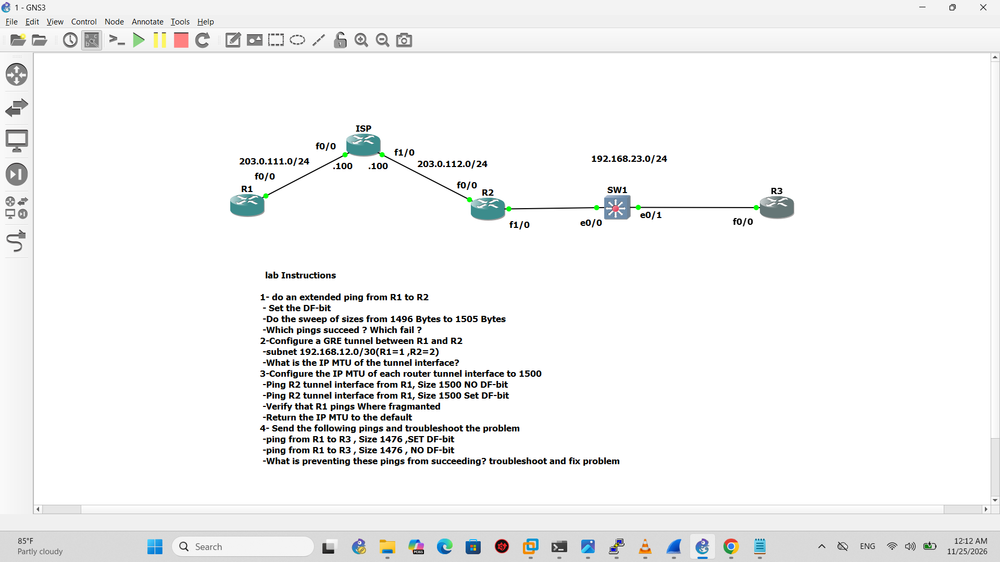

# Lab 04 – GRE Tunnel, MTU, Path MTU Discovery & IP Fragmentation

## 1. Overview

This lab investigates how Generic Routing Encapsulation (GRE) affects packet transmission, particularly the relationship between MTU, GRE encapsulation overhead, fragmentation, and Path MTU Discovery (PMTUD).

A GRE tunnel was established between R1 and R2 across an ISP underlay network. Different packet sizes and DF-bit settings were tested to observe their impact on connectivity.

The lab focuses on understanding and troubleshooting MTU-related issues in GRE tunnel environments.

## 2. Lab Objectives

- Configure and verify a GRE tunnel between two Cisco routers.
- Understand the difference between underlay MTU and tunnel IP MTU.
- Calculate GRE encapsulation overhead.
- Investigate the effect of configuring a tunnel MTU larger than its transport MTU.
- Test packet transmission using different datagram sizes.
- Understand the role of the Don't Fragment (DF) bit.
- Explore GRE tunnel Path MTU Discovery behavior.
- Verify end-to-end connectivity through the tunnel.

## 3. Lab Topology

The topology contains two GRE tunnel endpoints, R1 and R2, connected through an ISP router. R2 provides connectivity to an internal network containing R3.



### Network Devices

| Device | Role |
|---|---|
| R1 | GRE tunnel endpoint |
| ISP | Underlay network router |
| R2 | GRE tunnel endpoint |
| SW1 | Layer 2 switch |
| R3 | Internal destination router |

## 4. IP Addressing

| Device | Interface | IP Address | Subnet Mask |
|---|---|---|---|
| R1 | Fa0/0 | 203.0.111.1 | 255.255.255.0 |
| ISP | Fa0/0 | 203.0.111.100 | 255.255.255.0 |
| ISP | Fa1/0 | 203.0.112.100 | 255.255.255.0 |
| R2 | Fa0/0 | 203.0.112.2 | 255.255.255.0 |
| R2 | Fa1/0 | 192.168.23.2 | 255.255.255.0 |
| R3 | Fa0/0 | 192.168.23.3 | 255.255.255.0 |
| R1 | Tunnel0 | 192.168.12.1 | 255.255.255.252 |
| R2 | Tunnel0 | 192.168.12.2 | 255.255.255.252 |

## 5. GRE Tunnel Configuration

### R1 Configuration

```cisco
interface Tunnel0
 ip address 192.168.12.1 255.255.255.252
 ip mtu 1476
 tunnel source FastEthernet0/0
 tunnel destination 203.0.112.2
 tunnel path-mtu-discovery
```

### R2 Configuration

```cisco
interface Tunnel0
 ip address 192.168.12.2 255.255.255.252
 ip mtu 1476
 tunnel source 203.0.112.2
 tunnel destination 203.0.111.1
```

## 6. Baseline Connectivity Verification

Before testing MTU behavior, connectivity was verified from R1.

| Destination | Purpose | Result |
|---|---|---|
| 203.0.112.2 | R2 underlay address | 5/5 successful |
| 192.168.12.2 | R2 tunnel address | 5/5 successful |
| 192.168.23.3 | R3 internal address | 5/5 successful |

**Observation:**

The GRE tunnel was operational, and R1 successfully reached both the remote tunnel endpoint and the internal destination behind R2.

## 7. Exercise 1 – Underlay MTU Testing

The first experiment examined packet transmission across the physical underlay between R1 and R2.

An extended ping was performed from R1 to the R2 underlay address `203.0.112.2`, with the DF bit enabled.

### Test Results

| Datagram Size | Result |
|---|---|
| 1496 bytes | Success |
| 1497 bytes | Success |
| 1498 bytes | Success |
| 1499 bytes | Success |
| 1500 bytes | Success |
| 1501–1505 bytes | Timeout |

**Observation:**

The largest successful tested datagram size was 1500 bytes. All larger tested sizes timed out.

This established the observed packet-size threshold for this underlay ping test.

## 8. Exercise 2 – GRE Encapsulation and Tunnel MTU

GRE encapsulation adds additional headers to the original IP packet.

For standard IPv4 GRE encapsulation without optional GRE fields:

| Header | Size |
|---|---:|
| Outer IPv4 header | 20 bytes |
| GRE header | 4 bytes |
| Total overhead | 24 bytes |

### MTU Calculation

Assuming a 1500-byte underlay MTU:

```text
Tunnel IP MTU = Underlay MTU - GRE overhead

Tunnel IP MTU = 1500 - 24

Tunnel IP MTU = 1476 bytes
```

### Verification Commands

```cisco
show interfaces Tunnel0
show ip interface Tunnel0
```

### Actual Router Results

Both R1 and R2 reported:

| Parameter | Observed Value |
|---|---:|
| Logical interface MTU (`show interfaces`) | 17916 bytes |
| Tunnel transport MTU | 1476 bytes |
| IP MTU (`show ip interface`) | 1476 bytes |

**Technical Explanation:**

The effective tunnel IP MTU was 1476 bytes, matching the calculated value.

The 17916-byte value displayed by `show interfaces Tunnel0` represents the logical interface MTU reported by IOS. It should not be confused with the effective IP MTU shown by `show ip interface Tunnel0`.

### Tunnel Verification Screenshots

**R1 – GRE Tunnel Up**


**R2 – GRE Tunnel Up**


## 9. Exercise 3 – Configuring Tunnel IP MTU to 1500

The next experiment tested what happens when the GRE tunnel IP MTU is configured to 1500 bytes, even though the tunnel transport MTU is 1476 bytes.

### Configuration Applied on Both Routers

```cisco
configure terminal
interface Tunnel0
 ip mtu 1500
end
```

### IOS Warning

Both routers displayed warnings indicating that the configured IP MTU exceeded the tunnel transport MTU.

```text
%Warning: IP MTU value set 1500 is greater than the current transport value 1476, fragmentation may occur

%TUN-4-MTUCONFIGEXCEEDSTRMTU_IPV4: Tunnel0 IPv4 MTU configured 1500 exceeds tunnel transport MTU 1476
```

The configured tunnel IP MTU was subsequently verified as 1500 bytes.

### Extended Ping Tests

From R1 to the remote tunnel endpoint `192.168.12.2`:

| Datagram Size | DF Bit | Result |
|---|---|---|
| 1500 bytes | Disabled | Success |
| 1500 bytes | Enabled | Timeout |

**Observation:**

The ping succeeded when fragmentation was permitted and timed out when the DF bit was enabled.

This behavior is consistent with fragmentation being permitted when DF is disabled and prohibited when DF is enabled. However, a packet capture would be necessary to independently confirm the actual fragmentation process.

### Restore the Original MTU

After completing the experiment, the original MTU was restored on both routers.

```cisco
configure terminal
interface Tunnel0
 ip mtu 1476
end
```

## 10. Exercise 4 – End-to-End MTU Testing

The final experiment tested packet transmission from R1 to R3 through the GRE tunnel.

**Source:** `192.168.12.1`

**Destination:** `192.168.23.3`

### Test Results

| Datagram Size | DF Bit | Result |
|---|---|---|
| 1496 bytes | Enabled | Timeout |
| 1476 bytes | Enabled | Success |
| 1477 bytes | Enabled | Timeout |
| 1477 bytes | Disabled | Success |

**Observation:**

The largest successful tested datagram size with DF enabled was 1476 bytes.

The 1477-byte packet failed with DF enabled but succeeded with DF disabled.

These results are consistent with the configured tunnel MTU and the different behavior of packets when fragmentation is permitted or prohibited.

Actual fragmentation was not independently verified using packet capture.

## 11. Path MTU Discovery (PMTUD)

Path MTU Discovery is a mechanism used to determine the maximum packet size that can travel across a network path without requiring IP fragmentation.

In this lab, the following command was configured on R1:

```cisco
interface Tunnel0
 tunnel path-mtu-discovery
```

### Verification

```cisco
show interfaces Tunnel0
show ip interface Tunnel0
```

The R1 interface output displayed Path MTU Discovery information.

**Important:** PMTUD was configured on R1 only. The command was not configured on R2 during this experiment.

## 12. Final Tunnel Verification

After completing all experiments, the tunnel IP MTU was restored to 1476 bytes on both routers.

The following commands were used for final verification:

```cisco
show ip interface Tunnel0
show interfaces Tunnel0
```

### Final Results

| Parameter | R1 | R2 |
|---|---|---|
| Tunnel status | Up/Up | Up/Up |
| Tunnel IP address | 192.168.12.1/30 | 192.168.12.2/30 |
| IP MTU | 1476 bytes | 1476 bytes |
| Tunnel transport MTU | 1476 bytes | 1476 bytes |
| Input errors | 0 | 0 |
| Output errors | 0 | 0 |
| Output drops | 0 | 0 |
| Tunnel PMTUD command | Configured | Not configured |

**Result:** Both GRE tunnel interfaces were operational, and the original IP MTU configuration was restored.

## 13. Key Technical Takeaways

1. **GRE encapsulation overhead:** Standard IPv4 GRE adds 24 bytes of overhead when using a basic GRE header.
2. **Tunnel MTU calculation:** A 1500-byte underlay MTU results in a calculated GRE tunnel IP MTU of 1476 bytes.
3. **MTU mismatch:** Configuring a tunnel IP MTU larger than its transport MTU can produce IOS warnings and may cause fragmentation.
4. **DF bit:** The DF bit determines whether IPv4 fragmentation is permitted or prohibited.
5. **PMTUD:** Path MTU Discovery helps identify the usable packet size along a network path.
6. **Verification:** Successful tunnel status alone does not guarantee that larger packets can pass through the tunnel.

## 14. Lab Environment

- Cisco IOS routers
- GNS3 network simulator
- GRE tunneling
- IPv4 addressing and static routing
- Extended ping
- MTU and DF-bit testing
- IOS interface verification commands

## 15. Conclusion

This lab demonstrated the relationship between GRE encapsulation, MTU, packet fragmentation, and Path MTU Discovery.

The experiments confirmed that standard IPv4 GRE encapsulation adds 24 bytes of overhead, resulting in a calculated tunnel IP MTU of 1476 bytes when the underlay MTU is 1500 bytes.

The extended ping tests also demonstrated how packet size and the DF bit affect connectivity through a GRE tunnel.

An important troubleshooting lesson is that tunnel interfaces may remain operational while larger packets fail because of MTU-related limitations.

**Testing limitation:** All documented results are based on actual router configurations, command outputs, and ping tests. Actual IP fragmentation was not independently confirmed using Wireshark or another packet-capture tool.

## 16. Repository Structure

```text
Lab 04 - GRE Tunnel, MTU, Path MTU Discovery & IP Fragmentation/
│
├── README.md
│
├── topology/
│   └── topology.png
│
└── screenshots/
    ├── 01-R1-gre-tunnel-up.png
    ├── 01-R2-gre-tunnel-up.png
    ├── 02-underlay-mtu.png
    ├── 03-R1-gre-default-mtu.png
    ├── 03-R2-gre-default-mtu.png
    ├── 04-R1-gre-mtu-1500.png
    └── 05-R1-end-to-end-mtu.png
```

---

**Author:** Babiker Alnour Babiker Omer

**Repository:** [CCNP Enterprise Labs](https://github.com/babiker-alnour/CCNP-Enterprise-Labs)
